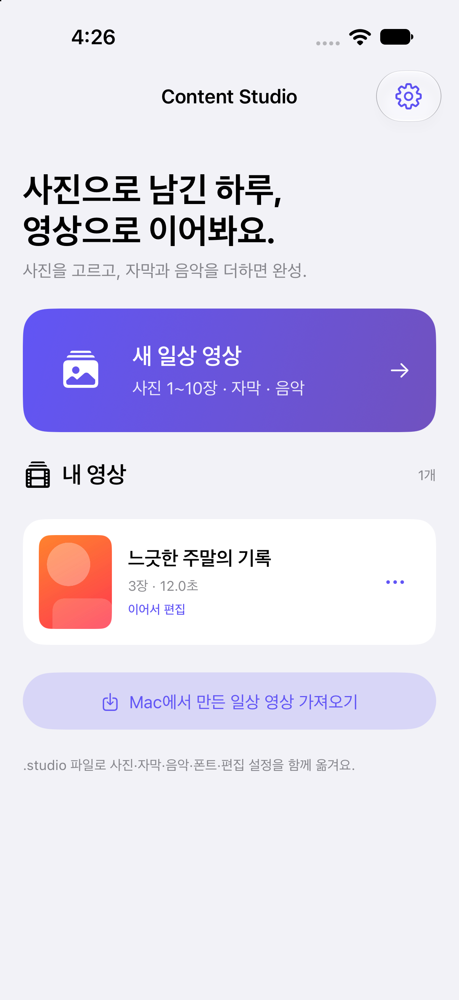
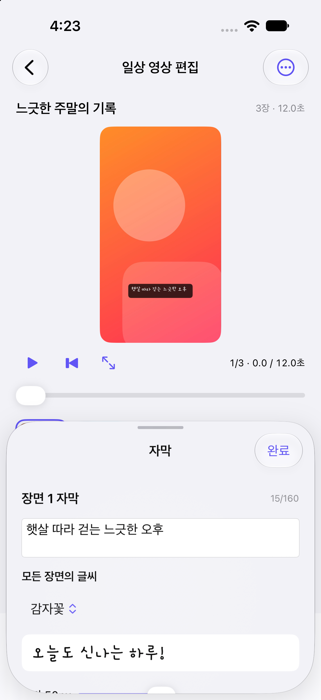

# Content Studio · 콘텐츠 스튜디오

사진과 뉴스로 자막·음악이 있는 **9:16 세로 영상**을 만드는 Mac·iPhone 앱입니다. 직접 편집은 AI 연결 없이 사용할 수 있고, 완성한 MP4를 저장해 인스타그램 등에 직접 게시합니다.

**Mac은 카드뉴스와 일상 영상을 모두 제작하고, iPhone은 일상 영상에 집중합니다.** iPhone에서도 Mac 일상 편집의 주요 설정을 사용할 수 있으며, `.studio` 파일로 기기 사이에서 작업을 이어갈 수 있습니다.

## 플랫폼별 기능

| 기능 | Mac | iPhone |
| --- | --- | --- |
| 사진으로 일상 영상 제작 | 지원 | 지원 |
| 뉴스·글로 카드뉴스 제작 | 지원 | Mac에서 편집 |
| 뉴스 검색·요약·관련 이미지 추천 | 지원 | 제공하지 않음 |
| 사진 기반 AI 자막 제안 | 지원 | 지원 |
| 사진 위치·장면 길이·순서 변경 | 지원 | 지원 |
| 폰트·자막 크기·위치·스타일 | 지원 | 지원 |
| 사진 움직임·장면 전환·실시간 미리보기 | 지원 | 지원 |
| 음악 선택·첨부·미리듣기·음량·시작 구간 | 지원 | 지원 |
| 기기 내 MP4 제작·저장 | 지원 | 지원 |
| 일상 프로젝트 파일 교환 | 지원 | 지원 |

### 일상 영상 편집

- 사진 1~10장을 선택하면 큰 이미지를 자동 축소합니다. 기본값은 사진이 9:16 영상 화면을 채우는 방식이며, 사진 전체 표시와 가로·세로 위치 조절도 가능합니다.
- 사진과 자막을 장면 단위로 함께 옮기고, 장면 길이를 2~30초 범위에서 조절합니다. 전체 영상 길이는 최대 180초입니다.
- 기본 폰트 외에 무료 폰트 9종과 직접 첨부한 TTF·OTF를 선택합니다. 자막 크기, 위치, 반투명 박스·심플 텍스트 스타일을 바꿀 수 있습니다.
- 사진 움직임은 정지·확대·축소·좌우 이동, 전환은 컷·페이드 중에서 선택합니다. 순서와 설정 변경은 실시간 미리보기에 반영됩니다.
- 분위기별 BGM 2~3곡을 추천합니다. 보내주신 YouTube Audio Library 채널에서 확인한 Kevin MacLeod 음악 8곡과 오리지널 3곡, 총 11곡 또는 MP3·M4A·WAV 파일을 사용합니다. 음악 시작 구간과 음량을 조절하고 영상 길이에 맞춰 반복·페이드 처리합니다.
- 분위기·사진 설명·말투를 입력해 AI 자막을 제안받거나 직접 작성할 수 있습니다.

### iPhone 제작 흐름과 화면

CC BY 4.0 곡은 출처 표기가 필요합니다. 일상 영상과 카드뉴스 모두 미리듣기·곡 선택을 제공하며, **문안 + 음악 출처 복사**와 **게시 문안 + 출처** 다운로드로 표기 문구를 함께 가져갈 수 있습니다. iPhone에서도 출처를 포함해 게시 문안을 공유합니다.

**새 일상 영상 → 사진 선택 → 분위기·자막 → 사진 / 자막 / 효과 / 음악 편집 → MP4 저장·공유**

편집 화면은 큰 미리보기, 사진 썸네일, 하단 편집 도구와 저장 버튼으로 구성됩니다. 편집 내용은 자동 저장하며, 미리보기 전체 화면 확대와 시간 이동을 지원합니다.

아래 화면은 개인 사진 대신 임시 예제 이미지를 사용한 실제 앱 화면입니다.

<p>
  
  
</p>

### Mac 카드뉴스 제작

뉴스 검색·인기뉴스 또는 직접 입력한 글에서 시작해 요약을 검토하고 카드·자막을 편집합니다. 선택한 AI로 초안을 만들고, 해당 뉴스에 맞는 공개 라이선스 이미지를 자동으로 추천·첨부할 수 있습니다. 카드 배경에는 영상 자막을 한 번만 표시하며, 출력 영상의 EDITORIAL / REELS·STUDIO 장식을 제거했습니다. 이미지 출처·라이선스 정보는 프로젝트와 게시 문안에 보존합니다.

## 시작하기

### Mac 개발 실행

Python 3.12 이상과 Node.js 22 이상이 필요합니다. 현재 개발 환경에서는 Python 3.14와 Node.js 26으로 확인했습니다.

```sh
git clone https://github.com/leelsm/insta-work.git
cd insta-work

python3 -m venv .venv
.venv/bin/python -m pip install -r requirements.txt

cd frontend
npm ci
npm run build
cd ..

.venv/bin/python run.py
```

앱 창과 로컬 서비스가 함께 실행됩니다. 마지막 앱 창을 닫거나 **스튜디오 종료**를 누르면 서비스가 종료됩니다. 기본 포트는 8080입니다. 저장된 포트나 기본 포트를 사용할 수 없으면 다음 포트(최대 20개)를 자동으로 시도하고, 고른 포트를 다음 실행에 사용합니다. 모두 사용할 수 없을 때만 앱에서 대체 포트를 선택하는 화면이 나타납니다.

개발용 브라우저 모드:

```sh
.venv/bin/python run.py --browser --port 8080
```

`--port`를 생략하면 앱 실행과 같은 방식으로 저장된 포트(처음에는 8080)부터 비어 있는 포트를 자동으로 찾습니다. `--port`로 지정한 포트는 그대로 사용하며, 사용할 수 없으면 오류를 표시하고 종료합니다. 터미널에 표시된 실행 주소로 접속합니다. 브라우저 탭을 닫아도 서버는 유지되므로 앱의 종료 버튼 또는 `Ctrl+C`로 종료하세요.

Windows 개발 시에는 `python -m venv .venv`와 `.venv\Scripts\python`을 사용합니다. Windows용 패키징 구성이 있지만 실행 검증은 별도로 필요합니다.

### iPhone 개발 실행

1. Mac의 Xcode에서 `ios/ContentStudio.xcodeproj`를 엽니다.
2. `ContentStudio` 타깃의 **Signing & Capabilities**에서 본인의 개발 팀을 선택합니다. 다른 계정으로 설치한다면 Bundle Identifier도 고유한 값으로 변경합니다.
3. iPhone 시뮬레이터 또는 연결한 iPhone을 선택하고 **Run**을 실행합니다.

iOS 17 이상을 지원하며, iPhone 앱은 Mac 서버 없이 사진 편집과 MP4 제작을 수행합니다. 실기기는 개발자 모드·개발자 앱 신뢰 설정이 필요할 수 있습니다. 자세한 내용은 [iPhone 앱 안내](ios/README.md)와 [설치·배포 안내](docs/IOS_INSTALL_GUIDE.md)를 확인하세요.

시뮬레이터용 빌드:

```sh
xcodebuild \
  -project ios/ContentStudio.xcodeproj \
  -scheme ContentStudio \
  -sdk iphonesimulator \
  -configuration Debug \
  -derivedDataPath /tmp/content-studio-ios \
  CODE_SIGNING_ALLOWED=NO build
```

현재 일반 다운로드용 TestFlight·App Store 배포는 완료되지 않았습니다. GitHub 소스와 Mac용 `.app`을 iPhone 설치 파일로 사용할 수는 없습니다.

## Mac·iPhone 프로젝트 교환

1. Mac 일상 영상 편집 화면의 **iPhone용 프로젝트**에서 `.studio` 파일을 만듭니다.
2. AirDrop·iCloud Drive 등으로 옮긴 뒤 iPhone 홈의 **앱 설정 → PC 버전에서 가져오기**에서 엽니다.
3. 반대로 iPhone의 **영상 메뉴 → 게시 문안 · PC 버전으로 보내기 → 프로젝트 파일 만들기**로 내보내고, Mac의 **내 콘텐츠 → iPhone 프로젝트 가져오기**에서 엽니다.

사진·음악·폰트·장면 순서·자막 설정·움직임·전환·분위기·설명·말투·음악 시작 구간을 함께 옮깁니다. API 키와 완성된 MP4는 포함하지 않으며, 자동 동기화 방식은 아닙니다. iPhone에 이미 저장된 카드 프로젝트는 보존하고 Mac으로 내보내기를 제공합니다.

## AI 연결과 데이터 저장

- 직접 자막 편집과 영상 제작에는 AI 키가 필요하지 않습니다.
- AI는 OpenAI·Claude 및 설정한 호환 서비스 등을 사용하며, 사진 자막에는 이미지 입력을 지원하는 모델이 필요합니다. API 사용료는 해당 제공자의 정책에 따릅니다.
- 사진 AI를 요청하면 축소한 사진과 설명이 선택한 AI 서비스로 전달됩니다. iPhone에서는 명시적인 사진 전송 버튼을 눌러야 요청합니다.
- 프로젝트와 미디어는 각 기기에 로컬 저장하고, API 키는 OS 보안 저장소·iPhone Keychain에 보관합니다. Mac 기본 데이터 위치는 `~/Library/Application Support/InstagramContentStudio`입니다.
- Mac의 로컬 전용 모드는 외부 AI·뉴스·음성 요청을 차단합니다. iPhone에서 Mac의 로컬 AI 서버를 쓰려면 기기에서 접속 가능한 별도 서버 주소가 필요합니다.
- 기본 사용 흐름은 MP4를 저장한 뒤 사용자가 직접 게시하는 방식입니다. 예약·자동 게시와 외부 영상 업로드는 현재 기본 기능으로 제공하지 않습니다.

[API 연결 준비 안내](docs/API_SETUP_GUIDE.md)

## 테스트와 패키징

```sh
# Python API·영상·저장·프로젝트 교환 테스트
.venv/bin/python -m pytest -q

# 프런트엔드 테스트와 프로덕션 빌드
cd frontend
npm test
npm run build
cd ..

# Mac 앱 패키징 — 프런트엔드 빌드 후 실행
.venv/bin/python -m pip install pyinstaller==6.22.3
.venv/bin/python scripts/build.py
```

Mac 결과물은 `dist/ContentStudio.app`, Windows 결과물은 `dist/ContentStudio/ContentStudio.exe`와 동반 파일입니다. 대상 OS에서 빌드해야 하며 Windows는 결과 폴더 전체를 배포합니다. [GitHub Actions 빌드](.github/workflows/build.yml)는 수동 실행 또는 `v*` 태그 푸시 시 Mac ARM·Mac Intel·Windows 빌드를 수행합니다.

2026-10-11 확인 상태:

- Python 테스트 **121개**, 프런트엔드 테스트 **8개** 통과 및 React·TypeScript 프로덕션 빌드 성공.
- iPhone 시뮬레이터·실기기용 빌드 성공. iPhone 15 Plus에 BGM 업데이트 빌드 5 설치·실행 확인. iPhone 16의 기존 개발용 앱 설치 기록도 있습니다.
- iPhone 15 Plus에서 제공 BGM 11곡의 실제 MP4 음악 합성, 분위기별 추천, 출처 포함 문안, 사진 축소, 프로젝트 교환, 움직임·제작 취소 등 **31개 검사** 통과. 검증은 별도 임시 프로젝트를 사용했으며, 업데이트 전후 기존 프로젝트 파일이 그대로 보존됐음을 확인했습니다.
- 실제 유료 AI 생성은 사용자 키·모델 연결 후 확인해야 합니다. 사진 AI 요청 형식 검사에서 유료 요청을 실행하지 않았습니다.
- Mac 정식 Developer ID 서명·공증, Windows 실행 검증 및 TestFlight 배포는 완료되지 않았습니다.

## 프로젝트 구조

2026-10-11 후속 수정: iPhone의 페이드 전환이 사진을 검게 덮어쓰는 문제를 고친 빌드 11과 Mac 최신 앱을 설치했습니다. 기존 일상 프로젝트의 MP4도 다시 제작하여 첫·마지막 화면, 모든 장면의 사진과 JPG를 확인했습니다. Python 136개·프런트엔드 9개 테스트, iPhone 실기기·시뮬레이터 각각 기능 65개 및 저장 화면 20개 검사를 통과했습니다. 검은 MP4가 공유된 이전 파일은 앱에서 새 MP4를 저장해 다시 보내세요.

```text
frontend/       React · TypeScript · Vite 데스크톱 화면
studio/         FastAPI · SQLite · AI/뉴스 연결 · FFmpeg 렌더러
ios/            SwiftUI · Keychain · AVFoundation iPhone 앱
resources/      앱 아이콘 · 음악 · 폰트 · 각 자료의 라이선스
tests/          Python 테스트
frontend/tests/ 프런트엔드 테스트
scripts/        앱 패키징 · 제공 음악 생성
examples/       직접 작성한 예제 영상과 자막
docs/           사용·설정·설치·설계 문서
```

두 앱은 각 플랫폼에 맞게 별도로 구현되어 있습니다. 공통 자료와 `.studio` 교환 형식을 사용하지만 Mac 코드 변경이 iPhone에 자동 반영되지는 않습니다. [구조와 플랫폼별 기능](docs/PROJECT_STRUCTURE.md)

## 문서와 제공 자료

- [사용 가이드](docs/USER_MANUAL.md)
- [API 설정 가이드](docs/API_SETUP_GUIDE.md)
- [iPhone 기능·개발 설치](ios/README.md)
- [iPhone 배포 안내](docs/IOS_INSTALL_GUIDE.md)
- [구현·검증 현황](docs/IMPLEMENTATION_STATUS.md)
- [예제 MP4·SRT](examples/README.md)
- [폰트 9종과 라이선스](resources/fonts/README.md)
- [제공 음악과 CC BY·CC0 안내](resources/music/LICENSE.md)
- [제3자 자료·배포 관련 안내](resources/THIRD_PARTY_NOTICES.md)

개인 사진이 포함된 작업 캡처, API 키, 프로젝트 내보내기 파일, 로컬 데이터베이스, 개발자 서명 파일과 빌드 결과물은 저장소에 포함하지 않습니다.
